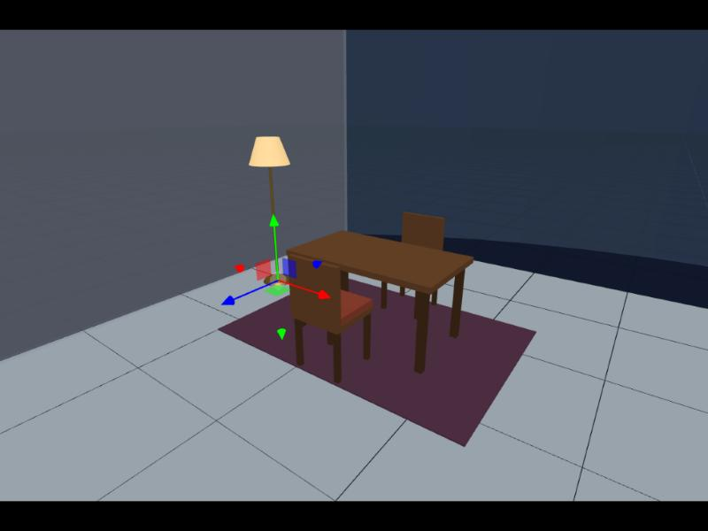
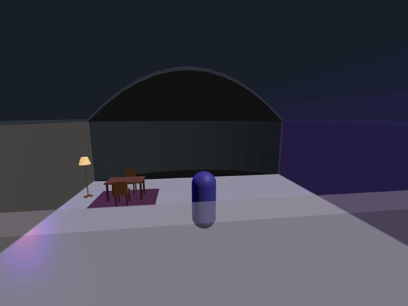

# Trial: a Claude session builds a scene in the editor from a prompt (2026-11-22)

**Question.** Can a Claude Code session drive the running editor from a prompt, save the
result, and have it replay through the existing load path, before PP-5 (in-app chat)
exists? What gets in the way? The answer is evidence for PP-3 (placement words) and
PP-4 (staged review).

**Answer: yes.** One scene was built from a prompt, saved, and played in `/room` with no
code change outside the opt-in debug hook. Everything that got in the way is listed below.

## Setup

- Hook: `window.__editorApi` on `/editor?editordebug` (SHARED
  `packages/ui/src/editor/debug/editorApi.ts`, wired in `SceneEditorView.vue`). It exposes
  `describeScene()`, `listAssets()`, `place(assetRef, {pos, yaw, scale}, label?)`,
  `move(id, pose)`, `remove(id)`, the NPC and zone commands, `undo()` / `redo()` /
  `history()` and `save(name?)`. Every write goes through the PP-1 history, so Ctrl+Z
  undoes it. Units are the PP-2 description units: metres, degrees, `pos` = pivot.
- Prompt loop: this Claude Code session calling the hook from the browser pane
  (`javascript_tool`). No chat panel and no API key.
- The local dev server ran from a session worktree. The deployed `/editor` still crashes.
- Prompt: the default one from the brief, *"a cosy room with a table, two chairs and a
  lamp"* (the owner was away).

## What happened

| Step | Result |
|---|---|
| Open `/editor?editordebug` | `__editorApi` present. **Asset library empty** in the browser pane's IndexedDB |
| Get assets | `__seedSpaceHome()` gave the room shell (floor, 3 walls, glass wall, vault, rib). **No furniture GLB exists** in the workspace, so Claude wrote table, chair, floor lamp and rug from box and cylinder primitives in the page (`GLTFExporter`) and put them into the library (`kind: 'prop'`) |
| `listAssets()` | Bounds for every model came back measured, e.g. chair `[[-0.23,0,-0.23],[0.23,0.93,0.23]]`. This is what made the coordinates computable |
| Build | 11 `place()` calls, 38 ms total. Shell from the space-home layout; rug, table, 2 chairs (yaw 0 / 180, facing the table), lamp |
| Check | Screenshot. Correct but not cosy: the set floated in the middle of a 10 × 10 m shell |
| Fix | 5 `move()` calls shifted the set into the north-west corner, and 1 more tucked the lamp in. Undo / redo checked on the lamp (`[-1.6,0.01,-3.5]` → `[1.2,0.01,-0.9]` → back) |
| Save | `save('cosy room (prompt-built)')` → `saved-hi8ZwLJy`, 11 objects, no gate warning |
| Replay | `/scenes` → Play → `/room?scene=saved-hi8ZwLJy`. Title shows, no console errors, and the layout matches the editor |

Not tested: walking into the furniture. P0-1 says every placed object can be walked
through; this trial did not drive the player, so that is expected, not observed.

## What hurt (evidence for PP-3 / PP-4)

Ranked by how much each one cost in this trial.

1. **No content for the prompt.** The library is per-browser IndexedDB and held nothing
   here. The workspace has no furniture at all (no table, chair or lamp GLB). Claude had
   to *author* primitive placeholders before placing anything. A burst-mode world needs a
   starter prop kit, or an "author a primitive" step that is part of the loop.
   → content-delivery track (CD), and a new item: a primitive prop generator next to
   `roomMeshGen.ts`.
2. **Coordinates are arithmetic, not words.** Every position was computed by hand from
   bounds: chair z = ±(table half-depth 0.4 + chair half-depth 0.23 − tuck 0.01), lamp
   "beside the table", set "in the corner" = wall − margin. It worked because
   `listAssets()` returns bounds. The words used were *on the rug, facing the table,
   beside, tucked into the corner, against the wall*. → **PP-3** placement words:
   `onTopOf`, `facing`, `beside(side, gap)`, `againstWall`, `inCorner`, `around(n)`.
3. **No group operation.** "Move the set into the corner" was 5 separate `move` calls,
   so 5 undo steps. → a group / selection transform, or a multi-command `execute` in one
   step (the history already supports multi-command entries; the hook does not expose
   them yet).
4. **Seeing the result is a workaround.** In a hidden browser pane `requestAnimationFrame`
   is suspended: the editor canvas was 0 × 0 and black. Claude rendered a frame by hand
   through `__editorViewport` and overlaid it as an `` to screenshot it. The room
   player has no debug handle, so its frame needed `requestAnimationFrame` swapped for a
   timer and the route remounted. → **PP-6** self-check screenshot: a `snapshot(camera)`
   that renders on demand, in the editor and in `/room`.
5. **Fixed-size shell assets.** The walls are 10 m generated meshes, and scale is uniform
   only, so a small cosy room needs new assets. A 6 × 4 m room cannot be made by placing.
   → a room-shell command (`room(w, d, h)`) that generates and places the walls (the
   generator already takes sizes).
6. **No light command.** The lamp is emissive and lights nothing. The scene has no light
   entity at all. → a light kind in the scene model (affects save, `loadRoom()` and the
   description).
7. **Asset names are not unique.** `space-home-wall-10x3.glb` exists twice, so lookup by
   name is ambiguous (`place()` takes the first match). The description uses ids, but
   prompts use names.
8. **Seeding adds rows.** `__seedSpaceHome()` also writes a "space home" scene row, which
   now shows in `/scenes`.
9. **No staged review.** Each `place` / `move` applied at once. That was fine here (undo
   worked every time), but a burst of 11 placements is 11 undo steps, with nothing that
   says "here is the plan, accept it". → **PP-4**: stage a command list, preview it,
   apply it as one step.

What did *not* hurt: the PP-1 history (undo / redo of a live `move` was exact; undo and
redo of a `place` are covered by the hook's unit test, not exercised live), the PP-2 bounds, save, and the `/scenes` → `/room` replay. Those worked as
built.

## Cost

About 12 page calls for build, check, fix and save, plus about 6 to get the screenshots
(the hidden-pane workaround). Placement itself is instant. In this trial the cost was
assets and seeing the result, not placing.
